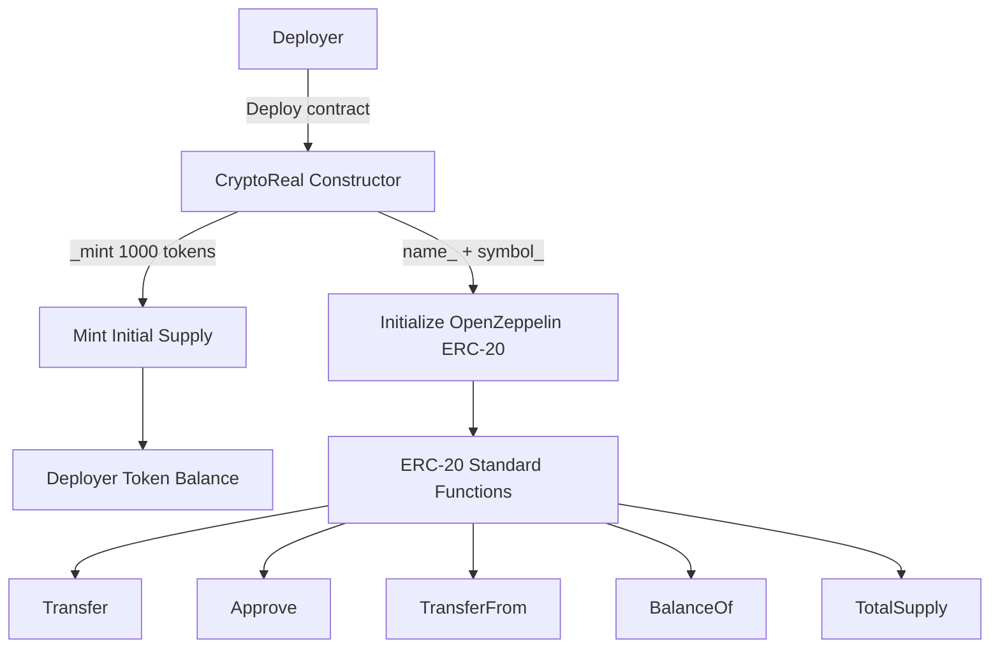

# <h1 align="center"> CryptoReal </h1>

This repository contains a Solidity project that implements a custom ERC-20 token using OpenZeppelin's ERC-20 implementation.

The contract creates a fungible token and automatically mints an initial supply of 1,000 tokens to the address that deploys the contract.

The main goal is to understand and practice the following Solidity and ERC-20 concepts:

- Contract inheritance.
- OpenZeppelin ERC-20 implementation.
- Constructor parameters.
- Parent constructor initialization.
- Token minting.
- Initial token supply.
- `msg.sender`.
- ERC-20 standard functionality.
- Token decimals.
- Solidity imports.
- Contract deployment.
- Smart contract state.

The contract is implemented in [`CryptoReal.sol`](./CryptoReal.sol).

### System flow



## Main features

The contract supports the creation of an ERC-20 token with the following characteristics:

- **Custom token name**: provided through the constructor.
- **Custom token symbol**: provided through the constructor.
- **Initial supply**: 1,000 tokens are minted when the contract is deployed.
- **Initial token owner**: the entire initial supply is assigned to the deployer's address.
- **ERC-20 functionality**: the contract inherits the standard ERC-20 implementation from OpenZeppelin.
- **18 decimals**: the token uses the default ERC-20 decimal value provided by OpenZeppelin.

## OpenZeppelin ERC-20 inheritance

The contract inherits from OpenZeppelin's ERC-20 implementation:

```solidity
contract CrytoReal is ERC20
```

This inheritance provides the standard ERC-20 functionality without implementing the token standard manually.

The contract imports the implementation with:

```solidity
import "@openzeppelin/contracts/token/ERC20/ERC20.sol";
```

This allows `CrytoReal` to use the functions and state management implemented by OpenZeppelin's ERC-20 contract.

## Constructor

The constructor receives the token name and symbol:

```solidity
constructor(string memory name_, string memory symbol_) ERC20(name_, symbol_)
```

The values are passed to the parent `ERC20` constructor:

```solidity
ERC20(name_, symbol_)
```

This initializes the token metadata inherited from OpenZeppelin.

## Initial token supply

During deployment, the contract executes:

```solidity
_mint(msg.sender, 1000 * 1e18);
```

This creates an initial supply of:

```text
1,000 tokens
```

The tokens are assigned to:

```solidity
msg.sender
```

which is the address that deploys the contract.

Because the ERC-20 implementation uses 18 decimals by default, the amount is represented internally as:

```text
1,000 × 10¹⁸
```

The initial token supply is therefore allocated entirely to the deployer's address.


## Contract behavior summary

This project demonstrates how to create an ERC-20 token by extending an existing standard implementation rather than implementing the complete token standard from scratch.

The main flow is:

```text
Deployer → CryptoReal → OpenZeppelin ERC-20 → Mint 1,000 tokens → Deployer balance
```

The project provides practical experience with Solidity inheritance, constructor arguments, parent constructor initialization, token minting, ERC-20 functionality and OpenZeppelin contracts.
